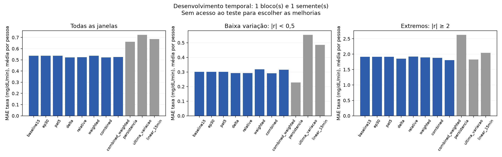

# Aprimoramento v2 — Triagem concluída e confirmação interrompida

**A combinação de CGM absoluto, diferenças e histórico relativo foi escolhida
provisoriamente para confirmação.** Na triagem B3, semente 42, seu MAE macro foi
**0,52182 mg/dL/min**, contra **0,53620** da referência refeita: ganho de **2,68%**,
com melhora nos **24 participantes**. Isso ainda não aprova a substituição da v1.

Estado desta versão do documento: triagem concluída; confirmação nos três blocos
e três sementes **interrompida por prazo de entrega**, a pedido da equipe;
`full_v2` e sua avaliação final no teste **não foram executados**.
Execução e análise produzidas com assistência automatizada a pedido da equipe.

## Método e referências preservadas

A tarefa permanece prever a taxa média futura em **+15 minutos** e representá-la
como seta contínua. A v1 e o `full_v1` continuam congelados como histórico.
O [protocolo efetivo](../../results/azt1d_seta/experiments/aprimoramento_v2/protocolo_execucao.json)
pré-registrou oito configurações e a execução por etapas: triagem das ideias e
combinações, seguida da confirmação da referência e da finalista. O rascunho
inicial da grade não descreve sozinho essa execução efetiva.

A triagem usou 24 pessoas, B3 e semente 42: treino nos primeiros 60% da grade,
escolha de época em 60–70% e comparação em 70–80%. Foram 166.073 janelas de
treino, 27.691 de `stop` e 27.381 de comparação, com origens iguais entre modelos.
Escalas vieram apenas do treino; o checkpoint usou MSE não ponderado no `stop`.

`baseline15` foi treinada novamente nesses mesmos dados e condições. Escalas em
`float64`, duas threads e a partição separada para época diferem do `full_v1`;
seus números antigos não são o comparador direto desta tabela. Os resultados são
médias das métricas por pessoa, em mg/dL/min.

## O que cada ideia produziu na triagem

Ganho positivo significa redução de MAE frente a `baseline15`. A coluna de
épocas distingue **limite / épocas executadas / melhor época no stop**.

| Configuração | MAE macro | Ganho | Épocas | Leitura da triagem |
|---|---:|---:|---:|---|
| `baseline15` | 0,53620 | Referência | 15 / 15 / 15 | Referência refeita |
| `ep30` | 0,53661 | −0,08% | 30 / 20 / 17 | Sem ganho no bloco de comparação |
| `pat5` | 0,53661 | −0,08% | 30 / 22 / 17 | Mesmo checkpoint de `ep30` |
| `delta` | 0,52229 | +2,59% | 15 / 13 / 10 | Passou as salvaguardas provisórias |
| `relative` | 0,52330 | +2,41% | 15 / 15 / 14 | Falhou em movimento espúrio e MAE extremo |
| `weighted` | 0,53571 | +0,09% | 15 / 15 / 14 | Ganho insuficiente e pioras secundárias |
| `combined` | **0,52182** | **+2,68%** | 30 / 15 / 10 | **Selecionada provisoriamente** |
| `combined_weighted` | 0,52530 | +2,03% | 30 / 15 / 10 | Piorou estabilidade apesar do ganho geral |

`delta` adicionou diferenças consecutivas e `relative` o canal relativo à leitura
da origem, sempre preservando o CGM absoluto. `combined` reuniu os três canais.
`weighted` e `combined_weighted` atribuíram peso inicial **1,5** aos alvos rápidos
de treino, mantendo peso 1 nos demais e dividindo a perda pela soma dos pesos.
Nenhuma dessas features usa informação posterior à origem da previsão.

O limite de 30 épocas não significou executar todas elas: a parada antecipada
encerrou `combined` na época 15, preservando a época 10. Aumentar épocas e
paciência isoladamente melhorou ligeiramente o MSE de `stop`, mas não o MAE do
bloco de comparação nesta semente. Isso não demonstra que mais treino sempre
piora; demonstra que esse aumento isolado não resolveu a triagem atual.

As três configurações absolutas compartilharam uma trajetória, com checkpoints
e paradas próprios. Houve **seis trajetórias físicas para oito configurações**,
e não oito treinos independentes. A etapa de triagem foi concluída em cerca de
12 min 49 s no executor paralelo de dois processos com duas threads cada.

## Estabilidade, mudanças rápidas e extremos

| Diagnóstico em B3 / semente 42 | `baseline15` | `combined` |
|---|---:|---:|
| MAE em baixa variação, taxa absoluta <0,5 | 0,30054 | 0,29050 |
| Previsão com módulo ≥0,5 em baixa variação | 16,54% | 15,87% |
| MAE nas mudanças rápidas, taxa absoluta ≥1 | 1,11660 | 1,09137 |
| Acerto de direção nas mudanças rápidas | 81,97% | 83,37% |
| Sinais opostos nas mudanças rápidas | 18,03% | 16,63% |
| MAE nos extremos, taxa absoluta ≥2 | 1,91308 | 1,87794 |
| Acerto de direção nos extremos | 84,69% | 86,65% |

As melhorias de `combined` passaram pelas salvaguardas desta triagem, mas os
problemas não foram eliminados: a persistência ainda teve MAE menor em baixa
variação (**0,22837**), e a última variação teve MAE extremo menor (**1,82728**).
`combined_weighted` chegou a **1,80620** nos extremos, porém elevou o movimento
previsto em baixa variação para **19,42%**, contra 16,54% da referência.
Portanto, resolver uma faixa transferindo o erro para outra não basta para
aprovar a mudança. As faixas usam o alvo real somente para diagnóstico.

## Confirmação e avaliação final

A confirmação começou a comparar `baseline15` e `combined` em B1, B2 e B3, com
sementes 42, 43 e 44, mas foi interrompida antes de completar a grade.
Na inspeção dos artefatos ao encerramento, havia **16 modelos completos** no
experimento: oito da triagem e dez artefatos da grade de confirmação, com dois
reaproveitados da triagem. Duas pastas de treino estavam parciais. Esses arquivos
permanecem preservados; grade incompleta não constitui confirmação.
O ganho mínimo de 2%, melhora na maioria das pessoas, consistência em blocos e
sementes e todas as salvaguardas precisam passar para aprovação final.

Não há resultado confirmatório nem intervalo de incerteza dessa grade completa
a publicar. Uma eventual retomada deve agregar blocos/sementes por pessoa
e apresentar a variação pareada, preservando sua dependência temporal. Três
sementes não são três populações independentes. Se a candidata falhar, a
referência permanece adotada e os ganhos parciais ficam registrados.

`combined` permanece candidata provisória, sem aprovação final; a referência v1
continua adotada. Nenhuma métrica nova de teste v2 foi usada para escolher a
finalista. O executor final, ainda não executado, registra a configuração e a
decisão antes de carregar o teste. Mesmo
depois disso, a avaliação continuará exploratória pelo acesso anterior ao teste
em rodadas v1; não constitui confirmação externa ou clínica.

## Artefatos para conferência

A auditoria da triagem registrou **470 verificações aprovadas, sem falhas**:
[verificação](../../results/azt1d_seta/experiments/aprimoramento_v2/verificacoes/triagem.json).
Os números acima vêm da [comparação](../../results/azt1d_seta/experiments/aprimoramento_v2/analise/triagem/comparison.csv),
[decisão provisória](../../results/azt1d_seta/experiments/aprimoramento_v2/analise/triagem/acceptance.json),
[épocas e custos](../../results/azt1d_seta/experiments/aprimoramento_v2/analise/triagem/training_cost.csv)
e [registro da etapa](../../results/azt1d_seta/experiments/aprimoramento_v2/stages/screening.json).
Reprodução e localização das fontes estão no [guia v2](../EXECUCAO_APRIMORAMENTO.md).

