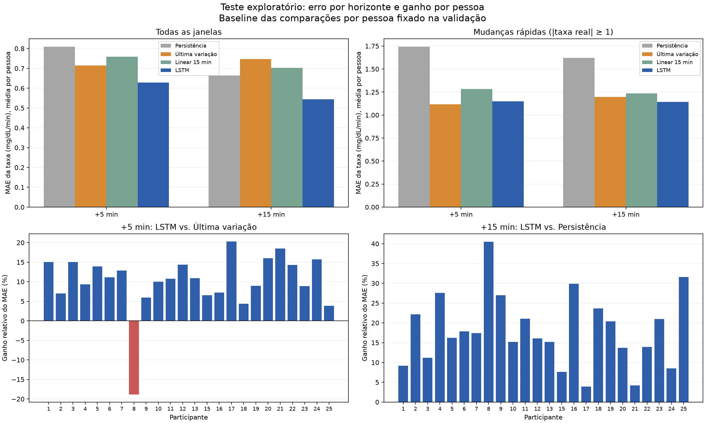

# full_v1 — Resultados da seta de tendência

**O horizonte de +15 minutos foi selecionado pela validação e manteve ganho no
teste:** MAE médio por pessoa de **0,5444 mg/dL/min**, contra **0,6640** da
persistência, uma redução de **18,02%**, com melhora nos 24 participantes.
O resultado sustenta usar essa versão como referência para aprimorar a seta.
Persistem erros em períodos estáveis e na magnitude das mudanças extremas.

Execução local em **07/11/2026, 21:43–21:49, horário de Brasília**, por automação
do assistente a pedido da equipe. O notebook completo foi executado; esta análise
também foi produzida com assistência automatizada e pode ser conferida nos
artefatos abaixo. A autoria das etapas históricas deve ser preenchida pela equipe
quando conhecida.

## Evidências e reprodução

- [Notebook executado](../../results/azt1d_seta/runs/full_v1/notebook_executado.ipynb).
- [Registro da execução](../../results/azt1d_seta/runs/full_v1/execucao.json),
  [manifesto](../../results/azt1d_seta/runs/full_v1/manifest.json) e
  [37 verificações aprovadas](../../results/azt1d_seta/runs/full_v1/verificacao.json).
- [Métricas completas](../../results/azt1d_seta/runs/full_v1/final/metricas.csv),
  [comparação por pessoa](../../results/azt1d_seta/runs/full_v1/analise/comparacao_por_pessoa.csv),
  [faixas de intensidade](../../results/azt1d_seta/runs/full_v1/analise/diagnostico_intensidade.csv) e
  [resumo numérico com identificação das fontes](../../results/azt1d_seta/runs/full_v1/analise/resumo_analitico.json).

Com o Python e as dependências descritos no [guia de execução](../EXECUCAO.md):

```powershell
python scripts/executar_experimento.py --run-name full_v1_reproducao --mode full
python scripts/verificar_experimento.py --run-name full_v1_reproducao
python scripts/analisar_resultados.py --run-name full_v1_reproducao
```

O nome novo preserva o `full_v1` registrado. O algoritmo não foi modificado nem
reajustado com os resultados do teste desta rodada. `quick_v1` foi preservado.

## Configuração efetivamente executada

| Item | Valor |
|---|---|
| Modo | `QUICK=False`, `RUN_NAME=full_v1` |
| Participantes | 24; Subject 14 excluído pelo alias ambíguo CGM/BGM |
| Janelas de treino / validação / teste | 166.073 / 55.394 / 55.010, sem redução por amostragem |
| Divisão | 60% / 20% / 20% cronológicos por pessoa, antes de criar janelas |
| Entrada | 12 leituras de CGM, espaçadas nominalmente em 5 min |
| Alvo | `(G(t+h)−G(t))/h`, em mg/dL/min, para +5 e +15 min |
| Modelo | Uma LSTM independente por horizonte, 32 unidades, saída linear |
| Otimização | Adam, taxa 0,001, lote 64, MSE padronizado, semente 42 |
| Treino | 15 épocas executadas em cada horizonte, com melhor estado na época 15 |
| Dispositivo | CPU; Python 3.14.8, PyTorch 2.15.0+cpu, NumPy 2.5.3, pandas 2.3.3 |
| Duração | Cerca de 5 min 44 s no fluxo completo; 143,6 s e 154,3 s nos treinos |

O código congelado tem SHA-256
`d20343826d24973c0ffd22afeb2966612e613e61fa4df7d56c7d2269acb23f63`.
Fontes, pesos e ambiente exato estão na pasta da rodada. As verificações
conferiram hashes, contagens, normalização a partir do treino, separação temporal,
pesos congelados, execução das células e recálculo do MAE a partir das previsões.

Na preparação dos 24 participantes, foram lidas 293.709 linhas e removidas 4.994
duplicatas completas. Dos 292.509 intervalos da grade, 6.002 ficaram ausentes ou
conflitantes, incluindo 722 conflitos de valores. Não houve interpolação.

Os horizontes são nominais na grade. A auditoria de toda a rodada registrou
intervalos entre leituras brutas de aproximadamente **0,97–9,05 min** para +5 e
**10,97–19,95 min** para +15; o maior desvio absoluto no percentil 95 por
pessoa/partição foi 1 min. Isso deve acompanhar a interpretação da taxa e motivar
diagnósticos futuros por irregularidade temporal.

## Escolha feita antes do teste

O [registro de seleção](../../results/azt1d_seta/runs/full_v1/selecao_horizonte.json)
foi salvo antes de calcular as métricas de teste. O baseline de referência foi
escolhido pelo MAE macro de validação de cada horizonte.

| Horizonte | Melhor baseline na validação | MAE baseline | MAE LSTM | Ganho relativo | Pessoas com ganho | Candidato |
|---|---|---:|---:|---:|---:|---|
| +5 min | Última variação | 0,7000 | 0,6196 | 11,49% | 23/24 | Não |
| +15 min | Persistência | 0,6683 | 0,5429 | 18,76% | 23/24 | Sim |

O +5 min falhou no critério de MAE em mudanças rápidas: **1,1236**, contra
**1,0792** da última variação. Seu ganho geral não foi suficiente para passar
pela regra completa. O +15 min passou pelos critérios gerais e rápidos, sendo o
único candidato. A escolha não foi alterada após observar o teste.

O menor MAE de taxa em horizontes diferentes não deve ser interpretado
isoladamente como uma comparação equivalente: a mudança média em 15 min é um
alvo diferente da mudança média em 5 min. A seleção usa ganhos relativos e
critérios explícitos, descritos no [protocolo](../PROTOCOLO_ATUAL.md).

## Resultado de teste

Os valores abaixo são **médias das métricas por pessoa**. O ganho é
`1 − MAE_LSTM/MAE_baseline`, usando o baseline fixado na validação.

| Horizonte | Baseline fixado | MAE baseline | MAE LSTM | Ganho | Pessoas com ganho | RMSE glicemia baseline / LSTM |
|---|---|---:|---:|---:|---:|---:|
| +5 min | Última variação | 0,7148 | 0,6282 | 12,12% | 23/24 | 5,435 / 4,664 mg/dL |
| **+15 min** | **Persistência** | **0,6640** | **0,5444** | **18,02%** | **24/24** | **13,902 / 11,701 mg/dL** |

Para +15 min, o MAE equivalente da glicemia prevista é **8,166 mg/dL** na LSTM,
contra **9,960 mg/dL** na persistência. Não se trata de outra tarefa: decorre da
identidade entre taxa e glicemia no horizonte fixo.

Todos os participantes tiveram ganho em +15 min, mas sua dimensão variou:
aproximadamente **3,88% no Subject 17** a **40,50% no Subject 8**. No +5 min, o
Subject 8 foi a exceção, com piora de 18,83% frente à última variação.

Reunindo todas as janelas de +15 min, o MAE da LSTM foi **0,54436** e o da
persistência **0,66247**. A conclusão geral é compatível com a média por pessoa,
que permanece a métrica principal para não dar mais peso a séries maiores.

O bootstrap pareado de participantes, com 10.000 reamostragens e semente 42,
produziu diferença média `MAE_persistência − MAE_LSTM` de **0,1197 mg/dL/min**, com
intervalo percentil descritivo de 95% **[0,0950; 0,1458]**. A reamostragem foi por
pessoa, preservando o par de modelos, e não por janela sobreposta. Esse intervalo
é condicionado aos modelos, participantes e divisão desta rodada; não inclui
variabilidade entre treinamentos nem estabelece generalização para novas pessoas.



## Onde o algoritmo ainda falha

Em mudanças rápidas, definidas por `|taxa real|≥1`, +15 min teve **12.414 janelas**,
22,57% do teste. O MAE macro da LSTM foi **1,1424**, contra **1,6220** da
persistência e **1,1964** da última variação. Portanto, nesta rodada o ganho rápido
também existe frente ao baseline que foi melhor nesse subconjunto, embora seja
menor: aproximadamente **4,51%** frente à última variação.

A LSTM acertou a direção em **82,30%** e apontou direção oposta em **17,70%**, na
média por pessoa das mudanças rápidas. A última variação teve 76,24% de acerto e
19,12% de sinais opostos; parte de suas outras previsões era zero. Persistência
sempre prevê zero e não fornece antecipação direcional; o protocolo conta zero
como erro quando a taxa real é não nula.

O diagnóstico por intensidade revela dois pontos que a média geral esconde:

| Faixa da taxa real em +15 min | Janelas | MAE LSTM | Referência relevante | Leitura |
|---|---:|---:|---:|---|
| `\|r\|<0,5` | 29.115 | 0,2967 | Persistência: 0,2273 | Piora de 30,56% em trechos de baixa variação |
| `0,5≤\|r\|<1` | 13.481 | 0,5139 | Persistência: 0,7027 | Ganho em mudanças moderadas |
| `1≤\|r\|<2` | 9.580 | 0,9217 | Última variação: 1,0431 | Ganho na faixa rápida intermediária |
| `\|r\|≥2` | 2.834 | 1,9461 | Última variação: 1,7658 | Piora de 10,21% na magnitude dos extremos |

Todas as faixas têm suporte nos 24 participantes. O acerto de direção nos
extremos chegou a **85,30%**, mas a magnitude prevista ficou comprimida. Em médias
reunidas das janelas extremas, as subidas reais foram +2,700 e as previstas +0,744;
nas descidas, −2,609 e −0,593 mg/dL/min. Esse diagnóstico é compatível com uma
previsão conservadora da intensidade, sem provar sua causa.

As faixas usam a taxa **real futura** para diagnóstico. Ela não está disponível
na inferência: não é possível escolher persistência para trechos estáveis ou
última variação para extremos usando diretamente essa classificação. Qualquer
adaptação do algoritmo precisa se apoiar apenas em sinais disponíveis no passado.

## Interpretação e continuidade

Há evidência consistente de ganho agregado da LSTM +15 min frente aos três
baselines avaliados neste protocolo, inclusive no subconjunto rápido agregado.
A proximidade entre validação e teste é favorável como diagnóstico, mas ainda
há uma única semente e um único desenho temporal. Os treinos atingiram a época
máxima ainda melhorando a validação; um orçamento maior é uma hipótese de
aprimoramento a testar, não uma melhora já demonstrada.

**A avaliação é exploratória.** `quick_v1` já havia acessado parte dos períodos
de teste agora incluídos no full; por isso a seleção registra
`exploratory_prior_test_access=true`. As mesmas pessoas aparecem no treino e em
períodos posteriores de avaliação. Não há demonstração de desempenho em pessoas
nunca vistas, validação clínica ou superioridade quantitativa sobre tentativas
antigas com outra tarefa e outro protocolo.

O [plano de aprimoramento](../PLANO_APRIMORAMENTO.md) mantém o foco na seta +15 min:
melhorar a representação causal da tendência, reduzir erros em estabilidade e nos
extremos e medir consistência entre sementes e blocos temporais. `full_v1` fica
congelado como referência; as próximas escolhas usam treino e validação.
