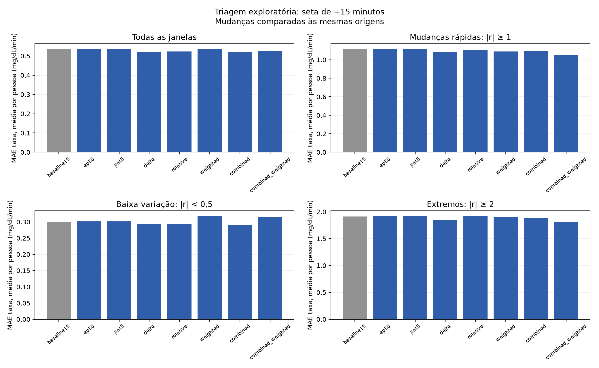

# Aprimoramento da seta de +15 minutos

Relatório gerado automaticamente dos artefatos reais de desenvolvimento. O algoritmo v1 e seus resultados permanecem preservados. Nenhum resultado de teste final é lido por este gerador.

## Triagem das ideias

Blocos: B3; sementes: 42. Configurações materializadas: 8. Horizonte fixo: +15 minutos.

As métricas são calculadas por pessoa em cada bloco/semente. O resumo faz a média dos blocos/sementes por pessoa e depois atribui peso igual às pessoas.

| Configuração | MAE geral | Ganho frente à referência | MAE rápido | MAE baixa variação | MAE extremos | Movimento em baixa variação |
|---|---:|---:|---:|---:|---:|---:|
| Referência 15 épocas (`baseline15`) | 0,5362 | 0,00% | 1,1166 | 0,3005 | 1,9131 | 16,54% |
| Até 30 épocas (`ep30`) | 0,5366 | -0,08% | 1,1176 | 0,3015 | 1,9162 | 16,85% |
| Paciência 5 (`pat5`) | 0,5366 | -0,08% | 1,1176 | 0,3015 | 1,9162 | 16,85% |
| CGM + diferenças (`delta`) | 0,5223 | 2,59% | 1,0824 | 0,2929 | 1,8526 | 15,73% |
| CGM + canal relativo (`relative`) | 0,5233 | 2,41% | 1,1020 | 0,2925 | 1,9231 | 16,56% |
| Perda ponderada (`weighted`) | 0,5357 | 0,09% | 1,0887 | 0,3183 | 1,8958 | 20,98% |
| Canais combinados (`combined`) | 0,5218 | 2,68% | 1,0914 | 0,2905 | 1,8779 | 15,87% |
| Canais + perda ponderada (`combined_weighted`) | 0,5253 | 2,03% | 1,0493 | 0,3149 | 1,8062 | 19,42% |

Ganho positivo favorece a candidata. MAE em mg/dL/min. Movimento em baixa variação é a proporção de previsões com magnitude ≥0,5 quando a taxa real tem magnitude <0,5. A taxa real define a análise retrospectiva, não uma feature disponível em execução.

O melhor baseline simples no desenvolvimento foi **Persistência**, com MAE geral **0,6615**. Este comparador foi calculado nos mesmos blocos; não foi escolhido no teste.

O menor MAE geral entre as configurações foi de **Canais combinados** (`combined`), **0,5218**, ganho de **2,68%** frente à referência. O menor erro geral, isoladamente, não determina a aprovação.

**Decisão provisória da triagem:** `combined`. Esta etapa não mede consistência em três blocos e três sementes; não aprova definitivamente uma mudança.

### Condições e trade-offs observados

- **Até 30 épocas** (`ep30`): ganho geral -0,08%; melhora em 54,17% das pessoas; condições não satisfeitas: ganho mínimo de 2% no MAE geral; MAE nas mudanças rápidas; MAE em baixa variação; redução de movimento previsto em baixa variação; MAE nos extremos.
- **Paciência 5** (`pat5`): ganho geral -0,08%; melhora em 54,17% das pessoas; condições não satisfeitas: ganho mínimo de 2% no MAE geral; MAE nas mudanças rápidas; MAE em baixa variação; redução de movimento previsto em baixa variação; MAE nos extremos.
- **CGM + diferenças** (`delta`): ganho geral 2,59%; melhora em 95,83% das pessoas; passou por todas as condições avaliadas nesta etapa.
- **CGM + canal relativo** (`relative`): ganho geral 2,41%; melhora em 95,83% das pessoas; condições não satisfeitas: redução de movimento previsto em baixa variação; MAE nos extremos.
- **Perda ponderada** (`weighted`): ganho geral 0,09%; melhora em 50,00% das pessoas; condições não satisfeitas: ganho mínimo de 2% no MAE geral; ganho na maioria das pessoas; acerto direcional nas mudanças rápidas; sinais opostos nas mudanças rápidas; MAE em baixa variação; redução de movimento previsto em baixa variação; direção nos extremos.
- **Canais combinados** (`combined`): ganho geral 2,68%; melhora em 100,00% das pessoas; passou por todas as condições avaliadas nesta etapa.
- **Canais + perda ponderada** (`combined_weighted`): ganho geral 2,03%; melhora em 83,33% das pessoas; condições não satisfeitas: MAE em baixa variação; redução de movimento previsto em baixa variação.

### Direção e suporte

| Configuração | Acerto rápido | Sinais opostos rápidos | Acerto nos extremos | Pessoas avaliáveis nos extremos |
|---|---:|---:|---:|---:|
| `baseline15` | 81,97% | 18,03% | 84,69% | 24 |
| `ep30` | 82,18% | 17,82% | 84,99% | 24 |
| `pat5` | 82,18% | 17,82% | 84,99% | 24 |
| `delta` | 83,14% | 16,86% | 85,76% | 24 |
| `relative` | 82,74% | 17,26% | 85,31% | 24 |
| `weighted` | 81,49% | 18,51% | 84,38% | 24 |
| `combined` | 83,37% | 16,63% | 86,65% | 24 |
| `combined_weighted` | 83,31% | 16,69% | 86,35% | 24 |

A direção exclui taxa real exatamente zero. Prever zero não é acerto quando a mudança real é não nula. As contagens de previsões no CSV incluem repetições dos mesmos períodos entre sementes; não são novas observações independentes.

Fontes: [comparação](triagem/comparison.csv), [decisões](triagem/acceptance.json), [métricas por pessoa](triagem/metrics_by_person.csv) e [configuração do resumo](triagem/summary.json).

### Custo registrado

| Configuração | Épocas mínimas–máximas | Tempo médio registrado (s) |
|---|---:|---:|
| `baseline15` | 15–15 | 274,1 |
| `ep30` | 20–20 | 353,7 |
| `pat5` | 22–22 | 386,6 |
| `delta` | 13–13 | 248,4 |
| `relative` | 15–15 | 214,3 |
| `weighted` | 15–15 | 168,4 |
| `combined` | 15–15 | 174,8 |
| `combined_weighted` | 15–15 | 202,8 |

Limites de época e paciência podem compartilhar a mesma trajetória de otimização. Os tempos por artefato não devem ser somados como custo físico independente.

## Confirmação

Ainda não há relatório confirmatório completo. Os resultados acima permanecem provisórios.

## Leitura conjunta

A taxa prevista é convertida em uma seta contínua; melhorar sua representação visual não altera o erro preditivo. O objetivo das ablações é reduzir erro geral sem transferir a piora para estabilidade, intensidade extrema ou direção.

As faixas usam a taxa real futura somente para avaliar. Em execução, toda feature e qualquer regra de ajuste dependem exclusivamente do passado disponível e da própria previsão.

Esta pesquisa já examinou dados e resultados anteriores da mesma base. A validação temporal organiza o desenvolvimento, mas não recupera um teste externo intocado. Há janelas sobrepostas e períodos compartilhados entre blocos; sementes e janelas não devem ser contadas como indivíduos independentes.

